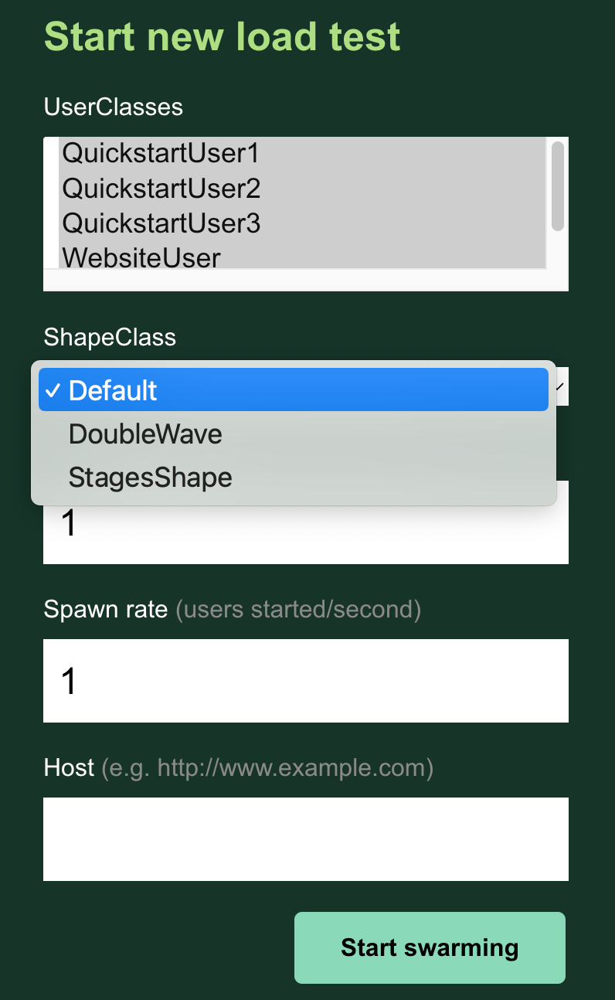

# Locust Loadester


## Using multiple Locustfiles at once
The ```-f/--locustfile``` option accepts a single directory of locustfiles as an option. Locust will recursively search the directory for ```*.py``` files, ignoring files named ```locust.py``` or those that start with ```“_”```.

Example:

With the following file structure:

```
├── locustfiles/
│   ├── locustfile1.py
│   ├── locustfile2.py
│   └── more_files/
│       ├── locustfile3.py
│       ├── locust.py
│       ├── _ignoreme.py/
```

```$ locust -f locustfiles```

Locust will use ```locustfile1.py```, ```locustfile2.py``` & ```more_files/locustfile3.py```

## Running Locust with User class UI picker
You can select which Shape class and which User classes to run in the WebUI when running locust with the ```--class-picker``` flag. No selection uses all of the available User classes.

Example:

With the following file structure:
```
├── src/
│   ├── some_file.py
├── locustfiles/
│   ├── locustfile1.py
│   ├── locustfile2.py
│   └── more_files/
│       ├── locustfile3.py
│       ├── locust.py
│       ├── _ignoreme.py
│   └── shape_classes/
│       ├── DoubleWaveShape.py
│       ├── StagesShape.py
```

```$ locust -f locustfiles --class-picker```

The Web UI will display:


 
Notes:
- re-deploy 04042023
- re-deploy 02052023
- re-deploy 1052023
-test
